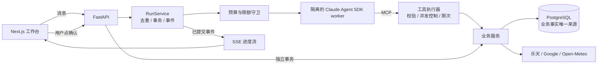

# 旅行规划 Agent

面向日本旅行的对话式规划助手：用户用聊天描述需求，Agent 比较乐天酒店、查询 Google 景点/路线和天气，生成一份经过校验的行程草稿，用户在页面确认后保存。确认过的偏好会跨会话记住。

**在线演示：** <https://web-production-0aaac.up.railway.app>　（Railway 部署：web / api / 模拟供应商 / PostgreSQL）

**设计原则：模型负责理解需求和编排工具；事实、金额、时间、归属、版本和任何副作用，都由确定性代码裁决。**

## 解决什么问题

规划一次日本旅行要在酒店、景点营业时间、交通耗时和预算之间反复权衡，改一处常常牵动全局。通用聊天模型能给建议，但会编造价格和营业时间，也不保证行程可执行。这个项目让模型负责“对话和调度”，让后端负责“可信和可执行”。

## 架构



- **模型可用 18 个工具**（查景点、比价、估路线、校验行程等），但没有“保存行程”或“下单”工具；保存只能由用户在页面点确认，走独立的 API 和数据库事务。
- **模型只传 ID**，价格、名称和来源由服务端按 ID 填入，模型无法编造报价。
- **旅行条件每轮从数据库重读**（带版本号），不依赖聊天记录；过期报价或旧版本的确认会被拒绝。
- **生成 → 校验 → 修复**：行程由纯代码校验（35+ 检查项：营业时间、路线间隔、预算、重复景点等）。冲突先由服务端做有界修复（最多 12 步，冲突数必须严格下降），修不掉再交还模型，轮数有上限。
- **服务端驱动交互**：条件齐全后由服务端发确认卡，而不是让模型自己决定怎么追问。
- **长期记忆**：后台抽取器只能提议，必须引用用户原话，用户点选才生效；只有 4 类偏好可长期保存。
- **Prompt 缓存**：system 只放稳定规则，每轮业务状态放在用户消息前，以提高前缀缓存命中率。
- **攻略库**：14 个日本城市、282 段中文 Wikivoyage 攻略（CC BY-SA 4.0，固定修订版本），供页面浏览和 Agent 检索引用。

技术栈：Python 3.12 / FastAPI / PostgreSQL / SQLAlchemy + Alembic / Next.js 16 + React 19 / Claude Agent SDK（DeepSeek 兼容线路）/ MCP / OpenTelemetry + Langfuse / GitHub Actions / Railway

## 质量、权限与监控

| 方面 | 做法 |
| --- | --- |
| **端到端评测** | 自建 30 道多轮任务（主流程、澄清、中途变更、9 种故障注入、越界、对抗、长期记忆），调用真实 DeepSeek / 乐天 / Google，每题跑 3 次。成败由代码检查数据库终态和工具轨迹，不靠模型自评 |
| **权限** | API 密钥只在父进程；SDK 子进程只拿本地回环令牌，按白名单继承环境变量。工具输入经 schema 校验，外部文本加围栏，防止注入扩权 |
| **成本与限额** | 每次模型请求先预占预算再结算；每次运行限制工具次数、轮数、HTTP 次数和超时；外部 API 有单次和每日配额 |
| **失败处理** | 429 / 超时 / 5xx 只在调用所属的那一层重试一次，失败如实报告真实尝试次数。模拟预订带幂等键，响应丢失进入 `unknown` 状态并先对账，不盲目重发 |
| **监控** | OpenTelemetry 记录每次运行、工具调用和模型请求；评测结果以数值分数推送 Langfuse（不上传对话正文）；Railway 上输出单行 TRACE 日志 |
| **工程** | ~2,470 条自动化测试（含真实 PostgreSQL 集成测试）、11 条分层导入契约、3 个 CI job；main 只能通过 PR 合入，Railway 等 CI 通过后才自动部署 |

## 结果

在自建的 30 题评测集上（DeepSeek flash，90 次真实运行，2026-10-20）：

| 指标 | 结果 |
| --- | --- |
| 任务成功率 | **96.7%**（87/90） |
| 稳定通过率（同一题 3 次全过） | **93.3%**（28/30） |
| 长期记忆 / 工具故障恢复 / 越界与对抗 | 18/18、15/15、15/15 |
| 单轮耗时 | 中位 8.0 秒，p95 32.9 秒 |
| 单次运行成本 | 中位 ¥0.15，p95 ¥0.96 |

需要说明的是：首轮原始成绩为 84.4% / 80%，修复评测脚本自身的问题并收紧判定后，重跑部分题目得到上表。这是系统（模型 + 服务端）在自建题集上的完成度，没有留出集，也不代表模型的通用能力。

## 失败如何变成防护

- **模型谎称“请在卡片里确认”，但卡片其实没发出。** → 改为条件齐全时由服务端一定发卡，并把卡片状态（已发 / 待提交 / 无）返回给模型，模型只能据此描述。
- **评测判定过松，把只有 1 个景点的“完整行程”判为成功。** → 补上“草稿无冲突”和“每个完整游玩日至少 2 个景点”的硬检查。之后每道题都会反问一句：如果 Agent 什么都没做对，这道题会失败吗？
- **一个本应离线的测试意外发起了真实付费调用。** → 在 pytest 环境下一律拒绝 `--live`，不再依赖“缺参数就会报错”这种隐含前提。
- **DeepSeek 偶发调用不存在的工具名。** → 守卫直接终止本轮，宁可让用户多发一句话，也不放宽这条安全边界。

## 已知不足

- 局部修改已有草稿不稳定（“只改第二天下午”只有 1/3 成功），规划完整度也有波动。
- 酒店预订是模拟的：线上只提供乐天链接，幂等和对账只针对模拟供应商。
- 只验证了 DeepSeek 线路，Claude 原生线路没有做真实验证。
- 2026-10-26 的优化（prompt 缓存、只读工具并发、skill 拆分、异步记忆抽取）已通过离线测试，但还没有重跑真实评测。

## 本地运行

需要 [uv](https://docs.astral.sh/uv/) 和 Docker Desktop。离线演示不需要任何 API key：

```bash
uv run python scripts/dev.py stack-up      # 构建并启动 API / 供应商 / PostgreSQL / 前端
uv run python -m scripts.smoke_demo        # 跑一遍端到端烟测
# 打开 http://127.0.0.1:3100
uv run python scripts/dev.py stack-down
```

开发环境、真实模型配置和预算设置见 [开发与运行手册](docs/guides/development.md)。

## 延伸阅读

- [架构与效果复盘](docs/review/architecture-retrospective.md)：设计取舍、详细结果和教训
- [代码架构地图](ARCHITECTURE.md) · [系统白话讲解](docs/guides/system-walkthrough.md) · [架构决策记录](docs/adr/)
- [评测结果与方法](docs/proposals/eval-redesign/results-2026-10-20.md)

本项目为个人项目，开发中使用了 AI 编码助手（Claude Code、Codex、Cursor）。架构取舍、评测设计、问题定位与验收由我负责。
