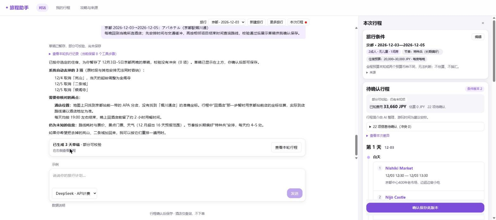
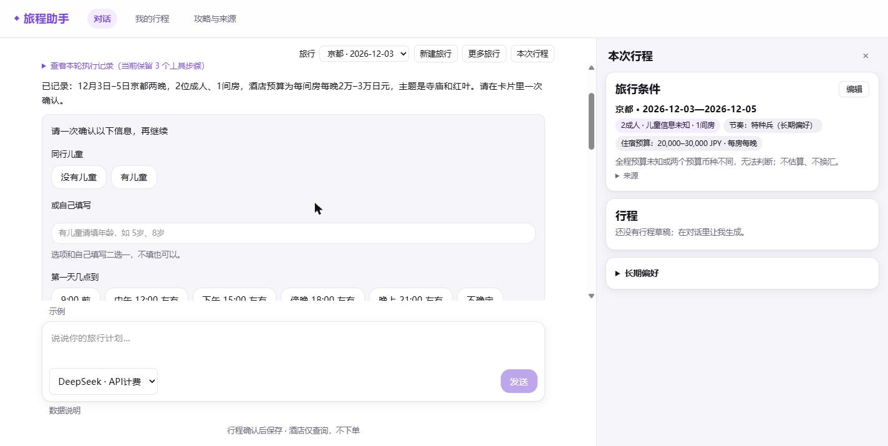
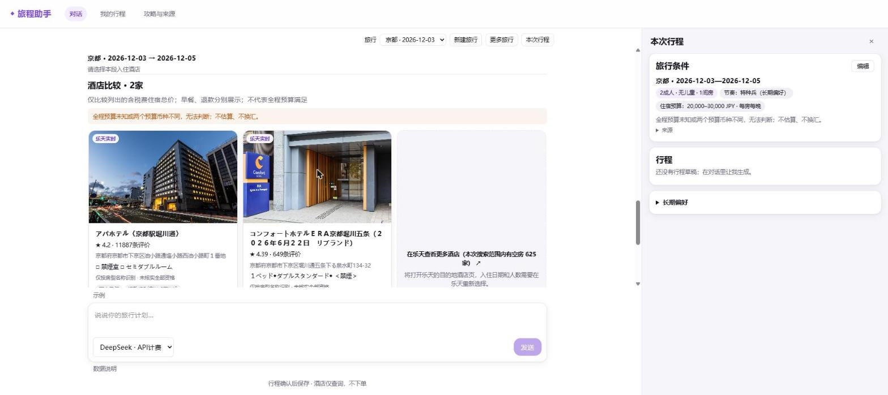
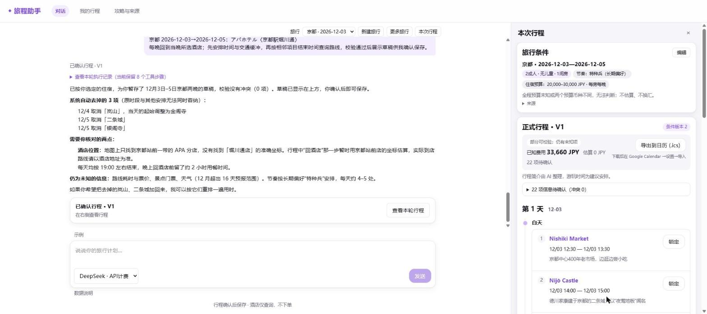
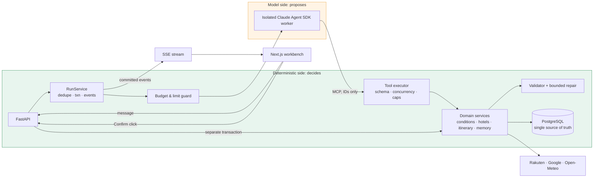

<div align="center">

# Travel Agent

**A production-style LLM agent that runs a multi-step business workflow against real APIs, without being allowed to make things up.**

English · [简体中文](README.zh-CN.md)

[](https://web-production-0aaac.up.railway.app)
[](https://github.com/Cookie0103/travel_agent/actions/workflows/check.yml)


</div>

<p align="center"></p>
<p align="center"><sub>A live run: the draft passed validation with 0 conflicts, the server dropped 3 stops that did not fit, and the agent lists exactly what still needs checking. Nothing is saved until the user clicks Confirm.</sub></p>

## Problem and approach

Planning a trip to Japan means trading off hotels, opening hours, transfer times and budget, and one change ripples through everything. A general chat model can make suggestions, but it invents prices and opening hours and cannot guarantee the plan is executable.

This agent splits the work along a hard line: **the model proposes, code disposes.** The model understands the request and orchestrates 18 tools over Rakuten Travel, Google Places / Routes and Open-Meteo. Facts, money, time, ownership, versions and every side effect are decided by deterministic code, and nothing is committed until the user approves it.

| | |
| --- | --- |
| **Task success** | **96.7%** (87/90 live multi-turn runs, 95% CI 90.7–98.9%) |
| **Stable pass** (all 3 trials of a task pass) | **93.3%** (28/30) |
| **Fault recovery · long-term memory · adversarial** | 15/15 · 18/18 · 6/6 |
| **Claims contradicted by actual state** | **0** across 90 runs |
| **Latency** | median 8.0 s per turn, first useful reply 5.2 s |
| **Cost per full trip plan** (4 user turns) | ≈ RMB 0.95 (≈ US$0.13) |

<table>
<tr>
<td width="33%"></td>
<td width="33%"></td>
<td width="33%"></td>
</tr>
<tr>
<td align="center"><sub>Server-issued confirmation card</sub></td>
<td align="center"><sub>Live Rakuten offers, server-filled prices</sub></td>
<td align="center"><sub>Confirmed trip V1, saved by the user</sub></td>
</tr>
</table>

## Quick start

You need [uv](https://docs.astral.sh/uv/) and Docker. The offline demo needs **no API keys**:

```bash
uv run python scripts/dev.py stack-up      # API, mock supplier, PostgreSQL, web
uv run python -m scripts.smoke_demo        # end-to-end smoke test
# open http://127.0.0.1:3100
uv run python scripts/dev.py stack-down
```

Live models, API keys and budgets: [development guide](docs/guides/development.md).

## Architecture



One agent in a standard tool loop, with no intent router. Three chains are kept apart on purpose:

- **Execution:** message → RunService → guard → isolated SDK worker → MCP → tool executor → services → repositories.
- **Progress:** worker events → verified by the parent process → committed → SSE. Reconnecting replays saved events and never re-runs a tool or a model call.
- **Commit:** user click → confirm API → business transaction. No path from the model reaches it.

## Context engineering

- **Three separate state sources.** The SDK session holds model context, application events drive the UI, and PostgreSQL holds business truth. Business decisions read only the database, never the transcript.
- **State re-read every turn.** Travel conditions (with a revision number), active preferences and pending cards are rebuilt from the database and injected as a compact state block in front of the user message. Stale quotes or confirmations against an old revision are rejected.
- **A cache-stable system prompt.** `system` holds only stable rules and tool policy, byte-identical across turns. Everything volatile lives in the per-turn state block, so the cached prefix survives the whole conversation.
- **Skills instead of a bloated prompt.** Six domain playbooks (hotel comparison, itinerary revision, multi-city, budget relaxation, external errors, repair limits) load on demand from a whitelist, once per turn, with a content hash.
- **Compaction under control.** The SDK's auto-compaction switch is verified per pinned SDK/CLI version, and after a compaction the latest business state is re-injected so the model never plans against a summarized, outdated view.
- **Tool results shaped as context.** Results keep only the fields the model needs. Errors carry next-step guidance, and a committed-but-truncated write tells the model not to retry.

## Long-term memory

- **Memory lives in the database.** Preferences are typed, queryable fact rows, not a free-text profile. Only four keys may persist across trips (pace, transport, wake-up time, end-of-day time); lodging, smoking, bed type and companions stay scoped to one trip.
- **Asynchronous extraction.** After a turn completes, a background extractor reads the last 3 turns and proposes facts. The main agent has no memory tool and spends no latency on it.
- **Restricted extractor input.** The extractor sees only the user's own text and the assistant's final replies, never tool results, hotel listings or guide articles, so third-party text cannot become a "user preference".
- **Write-path validation in code.** Every proposal must quote the user verbatim (normalized, at least 4 characters) from a completed turn, and is checked again server-side before it is stored.
- **User control.** Each fact is confirmed on a card before it takes effect. Forgetting erases the fact text, sets a forget boundary that late writers cannot cross, and cuts SDK session continuation so the old context cannot leak back.
- **Verified end to end.** The eval checks four layers: extracted → persisted → present in the prompt actually sent to the model → reflected in behavior. Result: 18/18.

## Tools and guardrails

- **No write tools for the model.** 18 tools cover search, comparison, routing, validation and conversation state. None can save a trip or place an order; saving happens only when the user clicks Confirm, through a separate API and transaction.
- **Server-issued IDs only.** The model passes IDs; names, prices, sources and expiry are filled in by the server from those IDs, so a quote cannot be hallucinated.
- **Server-owned interaction.** Once city, dates, party and rooms are known, the server always issues one combined confirmation card and reports its real state (`sent` / `pending` / `none`) to the model. The model cannot claim a card that does not exist.
- **Generate → validate → bounded repair.** 35+ deterministic checks (opening hours, transfer gaps, budget, duplicates, …). Server-side repair is capped at 12 operations, the conflict count must strictly decrease, and no spot is ever added. Only what it cannot fix goes back to the model, with a round limit.
- **Untrusted text is fenced.** External content (listings, reviews, guides) is wrapped and size-capped so the model reports on it rather than obeys it.
- **Hard stops.** A call to a tool that does not exist terminates the turn. Per-run caps on tool calls, turns, HTTP calls and wall time; per-API single-run and daily quotas.
- **Isolated credentials.** API keys stay in the parent process. The SDK subprocess receives only a loopback token and an allow-listed environment.

## Latency and cost

- **Parallel read-only tools.** Pure queries (places, guides, facts, weather) run concurrently outside the session lock; state and write tools stay serialized.
- **Fewer model round-trips.** Server-issued cards replace free-form clarification, and deterministic repair fixes most validator conflicts without another model call.
- **Prefix caching by design.** Stable rules first, per-turn state last, skills loaded as tool results rather than edits to `system`.
- **Memory off the critical path.** Extraction runs after the turn has already been answered.
- **Reserve, then settle.** Every model request reserves budget before it is sent and settles on real usage.
- **Model is a config switch.** The runtime is built on the Claude Agent SDK; DeepSeek flash runs through its compatible endpoint, and Claude Haiku 5.5 is wired as a second route.

| Model | Price per 1M tokens (input / output) | One full trip plan (4 user turns) |
| --- | --- | --- |
| DeepSeek flash (default) | RMB 2 / RMB 8 (≈ US$0.28 / US$1.13) | ≈ RMB 0.95 (≈ US$0.13) |
| Claude Haiku 5.5 | US$0.10 / US$0.50 (≈ RMB 0.71 / RMB 3.55) | ≈ RMB 0.40 (≈ US$0.06) |

## Evaluation

- **30 multi-turn tasks × 3 trials, against real services.** Main flow, clarification, mid-conversation changes, 9 injected failure modes, out-of-scope, adversarial (fake system prompts, "skip confirmation") and long-term memory, all on real DeepSeek, Rakuten, Google and Open-Meteo.
- **Graded by state, not by the model.** Pass or fail comes from the final database state and the tool-call trace. A claim auditor checks 7 kinds of statements ("card sent", "retried twice", "within budget", "booked", "remembered", …) against what actually happened.
- **The harness is tested too.** Harness bugs are fixed separately from the agent, and every task must fail when the agent does nothing right. Ablation variants (no tools, no skills, no memory, no repair, no compaction) are built in.

| Category | Result | | Category | Result |
| --- | --- | --- | --- | --- |
| Main flow | 11/12 | | Fault recovery | 15/15 |
| Clarification | 15/15 | | Out-of-scope | 9/9 |
| Mid-conversation change | 13/15 | | Adversarial | 6/6 |
| Long-term memory | 18/18 | | **Total** | **87/90** |

Every incident became a permanent guardrail:

| Incident | Guardrail |
| --- | --- |
| The agent said "confirm in the card", but no card had been sent | The server always issues the card and returns its real state to the model |
| A two-night "complete plan" with one spot was graded as a pass | Hard checks: no conflicts in the draft, at least 2 distinct spots per full day |
| A supposedly offline test made a real paid call | `--live` is refused outright inside pytest |
| The model occasionally called a tool that does not exist | The guard terminates the turn instead of loosening the boundary |

## Operations

| Area | Implementation |
| --- | --- |
| **Failure handling** | 429 / timeout / 5xx retried once, only in the layer that owns the call (`Retry-After` capped at 3 s, 8 s per request), with the true attempt count reported. Booking carries an idempotency key; a lost response enters `unknown` and is reconciled before any resend. |
| **Observability** | OpenTelemetry spans per run, tool call and model request; eval scores pushed to Langfuse as numbers, without conversation text; single-line TRACE logs on Railway. |
| **External surface** | A public MCP server with 4 read-only tools, token-bucket rate limiting and a 64 KB request cap. |
| **Engineering** | 2,470+ tests including real PostgreSQL, 11 import-linter layering contracts, 29 ADRs, PR-only `main`, deploys only after CI passes. |

**Stack:** Python 3.12 · FastAPI · PostgreSQL · SQLAlchemy + Alembic · Next.js 16 · React 19 · Claude Agent SDK · MCP · OpenTelemetry · Langfuse · GitHub Actions · Docker · Railway

## Layout

| Directory | Contents |
| --- | --- |
| `backend/api` | HTTP routes, identity, SSE |
| `backend/services` | Use cases and transactions: conditions, hotels, itinerary, choice cards, memory |
| `backend/domain` | Pure rules: travel request, evidence, quotes, opening hours, validator |
| `backend/agent` · `backend/providers` | Agent contract and persona; Claude Agent SDK lifecycle, isolated worker, budget boundary |
| `backend/tools` | Tool schemas, executor, fencing, skills |
| `backend/adapters` | Rakuten, Google, weather and supplier clients with quotas and retries |
| `backend/persistence` | SQLAlchemy tables, repositories, Alembic migrations |
| `apps/web` | Next.js planning workbench and travel-guide library (14 cities, 282 Wikivoyage sections) |
| `eval` | Multi-turn simulator, graders, claim auditor, reports |
| `mock_supplier` | Booking supplier with fault injection |
| `docs` | Design, ADRs, security, reliability, retrospective |

## Further reading

- [Architecture retrospective](docs/review/architecture-retrospective.md) · [Eval report](docs/proposals/eval-redesign/results-2026-10-20.md) · [Code map](ARCHITECTURE.md)
- [System walkthrough](docs/guides/system-walkthrough.md) · [ADRs](docs/adr/) · [Security](docs/SECURITY.md) · [Reliability](docs/RELIABILITY.md)

<sub>Most design docs are written in Chinese.</sub>
