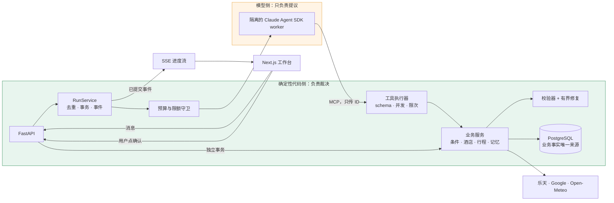

<div align="center">

# 旅行规划 Agent

**一个在真实 API 上执行多步骤业务流程、却不被允许编造任何事实的生产级 LLM Agent。**

[English](README.md) · 简体中文

[](https://web-production-0aaac.up.railway.app)
[](https://github.com/Cookie0103/travel_agent/actions/workflows/check.yml)


</div>

<p align="center"></p>
<p align="center"><sub>一次真实运行：草稿校验 0 冲突，服务端自动去掉 3 个排不下的景点，Agent 如实列出还需核对的信息；用户点"确认"之前，什么都不会保存。</sub></p>

## 业务问题与解决思路

规划一次日本旅行，要在酒店、景点营业时间、交通耗时和预算之间反复权衡，改一处常常牵动全局。通用聊天模型能给建议，但会编造价格和营业时间，也不保证行程真的能执行。

这个 Agent 沿一条硬边界分工：**模型负责提议，代码负责裁决。** 模型理解需求，编排 18 个工具，调用乐天旅行、Google 景点与路线、Open-Meteo 天气；事实、金额、时间、归属、版本和所有副作用都由确定性代码决定，用户批准之前什么都不会提交。

| | |
| --- | --- |
| **任务成功率** | **96.7%**（90 次真实多轮运行中 87 次成功，95% 置信区间 90.7%–98.9%） |
| **稳定通过率**（同一题 3 次全过） | **93.3%**（28/30） |
| **故障恢复 · 长期记忆 · 对抗** | 15/15 · 18/18 · 6/6 |
| **与实际状态不符的声明** | 90 次运行中 **0 次** |
| **响应速度** | 单轮中位 8.0 秒，首个可用回复中位 5.2 秒 |
| **完整规划一次的成本**（4 轮对话） | 约 0.95 元人民币（约 0.13 美元） |

<table>
<tr>
<td width="33%"></td>
<td width="33%"></td>
<td width="33%"></td>
</tr>
<tr>
<td align="center"><sub>服务端发出的合并确认卡</sub></td>
<td align="center"><sub>乐天实时报价，价格由服务端填入</sub></td>
<td align="center"><sub>用户确认后保存的正式行程 V1</sub></td>
</tr>
</table>

## 快速开始

需要 [uv](https://docs.astral.sh/uv/) 和 Docker。离线演示**不需要任何 API key**：

```bash
uv run python scripts/dev.py stack-up      # 启动 API / 模拟供应商 / PostgreSQL / 前端
uv run python -m scripts.smoke_demo        # 端到端烟测
# 打开 http://127.0.0.1:3100
uv run python scripts/dev.py stack-down
```

真实模型、API key 和预算配置见[开发与运行手册](docs/guides/development.md)。

## 架构



单个 Agent 跑标准工具循环，不设意图路由层。三条链路刻意分开：

- **执行链：** 消息 → RunService → 守卫 → 隔离的 SDK worker → MCP → 工具执行器 → 业务服务 → 仓储。
- **进度链：** worker 事件 → 父进程校验 → 事务提交 → SSE。断线重连只重放已保存的事件，绝不重新执行工具或模型。
- **确认链：** 用户点击 → 确认 API → 业务事务。模型没有任何路径能走到这里。

## 上下文管理

- **三个状态源分开。** SDK 会话只承载模型上下文，应用事件只驱动界面展示，PostgreSQL 才是业务事实。业务判断只读数据库，从不信聊天记录。
- **每轮重读状态。** 旅行条件（带版本号）、生效中的偏好和待处理卡片，每轮从数据库重建，作为一段精简的状态块放在用户消息前面。基于旧版本的报价或确认一律拒绝。
- **system 保持缓存稳定。** system 只放稳定规则和工具策略，跨轮逐字节不变；所有易变内容都放进每轮状态块，缓存前缀能贯穿整段对话。
- **用 Skill 代替臃肿的 prompt。** 6 份领域手册（酒店比较、行程修订、多城市、预算放宽、外部错误、修复上限）按白名单按需加载，每轮最多一次，附内容哈希。
- **上下文压缩可控。** SDK 自动压缩开关按固定的 SDK/CLI 版本逐一核验；压缩之后重新注入最新业务状态，模型不会对着被摘要过的旧状态做规划。
- **工具结果按上下文裁剪。** 只返回模型需要的字段；错误附带下一步提示；写入已提交但结果被截断时，明确告诉模型不要重试。

## 长期记忆

- **记忆存在数据库里。** 偏好是有类型、可查询的事实行，而不是一段自由文本画像。只有 4 类可以跨行程长期保存（节奏、交通方式、起床时间、每天结束时间）；住宿、禁烟、床型、同行人只对当次行程有效。
- **异步抽取。** 每轮结束后，后台抽取器读取最近 3 轮对话并提出候选事实。主 Agent 没有记忆工具，不为此多花一毫秒延迟。
- **严格限制抽取输入。** 抽取器只能看到用户原话和助手的最终回复，看不到工具结果、酒店信息或攻略文章，第三方文本不可能被记成"用户偏好"。
- **写入路径由代码校验。** 每条提议都必须逐字引用用户在已完成轮次中的原话（规范化后至少 4 个字），入库前服务端再核验一次。
- **用户掌控。** 每条事实都要用户在卡片上确认才生效。"遗忘"会清除事实正文，设置一条迟到写入无法越过的遗忘边界，并切断 SDK 会话续接，旧上下文无法回流。
- **端到端验证。** 评测逐层检查：抽取 → 落库 → 出现在真实发给模型的 prompt 里 → 体现在行为上。结果 18/18。

## 工具与安全边界

- **模型没有写工具。** 18 个工具覆盖搜索、比价、路线、校验和会话状态，没有一个能保存行程或下单。只有用户点"确认"才会保存，走独立的 API 和数据库事务。
- **只认服务端签发的 ID。** 模型只传 ID，名称、价格、来源和有效期都由服务端按 ID 填入，报价无从编造。
- **交互由服务端主导。** 城市、日期、人数、房间齐全后，服务端一定发出一张合并确认卡，并把卡片真实状态（已发 / 待提交 / 无）告诉模型。模型没法声称一张不存在的卡。
- **生成 → 校验 → 有界修复。** 35 项以上的确定性检查（营业时间、换乘间隔、预算、重复景点等）。服务端修复最多 12 步，冲突数必须严格下降，从不新增景点；修不掉的才带着轮数上限交还模型。
- **不可信文本加围栏。** 酒店信息、评论、攻略等外部内容会被包裹并限制长度，模型只能转述，不会照做。
- **硬性止损。** 调用不存在的工具会直接终止本轮。每次运行限制工具次数、轮数、HTTP 次数和时长；每个外部 API 都有单次运行和每日配额。
- **密钥隔离。** API 密钥只留在父进程；SDK 子进程只拿到本地回环令牌和白名单环境变量。

## 延迟与成本优化

- **只读工具并发。** 纯查询（景点、攻略、地点信息、天气）在会话锁之外并发执行；状态类和写入类工具保持串行。
- **减少模型往返。** 用服务端确认卡代替模型自由追问；大部分校验冲突由确定性修复解决，不用再调一次模型。
- **按前缀缓存设计。** 稳定规则在前、每轮状态在后；Skill 以工具结果的形式加载，不改动 system。
- **记忆不占关键路径。** 抽取在本轮回答发出之后才执行。
- **先预占、再结算。** 每次模型请求发出前先预占预算，按真实用量结算。
- **模型可随配置切换。** 运行时基于 Claude Agent SDK；DeepSeek flash 走兼容接口，Claude Haiku 5.5 已作为第二条线路接入。

| 模型 | 每百万 token 单价（输入 / 输出） | 完整规划一次（4 轮对话） |
| --- | --- | --- |
| DeepSeek flash（默认） | 人民币 2 元 / 8 元（约 0.28 / 1.13 美元） | 约 0.95 元人民币（约 0.13 美元） |
| Claude Haiku 5.5 | 0.10 美元 / 0.50 美元（约 0.71 / 3.55 元人民币） | 约 0.40 元人民币（约 0.06 美元） |

## 评测

- **30 道多轮题，每题 3 次，全部调用真实服务。** 覆盖主流程、需求澄清、中途变更、9 种故障注入、越界、对抗（伪造系统指令、要求跳过确认）和长期记忆，调用真实的 DeepSeek、乐天、Google 和 Open-Meteo。
- **按状态判分，不靠模型自评。** 成败由数据库终态和工具调用轨迹决定。声明对账器把 Agent 说出的 7 类话（"已发卡片""已重试两次""在预算内""已订好""已记住"等）逐条和实际发生的事比对。
- **测评工具本身也受检验。** 测评脚本的缺陷与 Agent 分开修复；每道题都必须满足"Agent 全做错时这题一定失败"。内置消融变体（去掉工具、Skill、记忆、修复、压缩）。

| 类别 | 结果 | | 类别 | 结果 |
| --- | --- | --- | --- | --- |
| 主流程 | 11/12 | | 故障恢复 | 15/15 |
| 需求澄清 | 15/15 | | 越界 | 9/9 |
| 中途变更 | 13/15 | | 对抗 | 6/6 |
| 长期记忆 | 18/18 | | **合计** | **87/90** |

每次事故都变成了一道永久防线：

| 事故 | 防线 |
| --- | --- |
| Agent 说"请在卡片里确认"，但卡片根本没发出 | 服务端一定发卡，并把卡片真实状态返回给模型 |
| 两晚只排一个景点的"完整行程"被判通过 | 新增硬检查：草稿无冲突，每个完整游玩日至少 2 个不同景点 |
| 一个本应离线的测试发起了真实付费调用 | pytest 环境下一律拒绝 `--live` |
| 模型偶发调用不存在的工具 | 守卫直接终止本轮，不放宽安全边界 |

## 运维

| 方面 | 做法 |
| --- | --- |
| **失败处理** | 429、超时、5xx 只在调用所属的那一层重试一次（`Retry-After` 最多等 3 秒，单次请求 8 秒超时），如实报告真实尝试次数。预订带幂等键，响应丢失进入 `unknown` 状态，先对账再决定是否重发 |
| **可观测性** | OpenTelemetry 为每次运行、工具调用和模型请求打 span；评测分数以数值推送 Langfuse，不上传对话正文；Railway 上输出单行 TRACE 日志 |
| **对外接口** | 对外 MCP server 提供 4 个只读工具，令牌桶限速，请求体上限 64 KB |
| **工程** | 2,470+ 自动化测试（含真实 PostgreSQL）、11 条分层导入契约、29 篇 ADR；main 只能通过 PR 合入，CI 通过后才部署 |

**技术栈：** Python 3.12 · FastAPI · PostgreSQL · SQLAlchemy + Alembic · Next.js 16 · React 19 · Claude Agent SDK · MCP · OpenTelemetry · Langfuse · GitHub Actions · Docker · Railway

## 目录结构

| 目录 | 内容 |
| --- | --- |
| `backend/api` | HTTP 路由、身份、SSE |
| `backend/services` | 用例与事务：旅行条件、酒店、行程、选择卡、记忆 |
| `backend/domain` | 纯规则：旅行需求、证据、报价、营业时间、校验器 |
| `backend/agent` · `backend/providers` | Agent 契约与人设；Claude Agent SDK 生命周期、隔离 worker、预算边界 |
| `backend/tools` | 工具 schema、执行器、围栏、Skill |
| `backend/adapters` | 乐天、Google、天气、供应商客户端，含配额与重试 |
| `backend/persistence` | SQLAlchemy 表、仓储、Alembic 迁移 |
| `apps/web` | Next.js 规划工作台与攻略库（14 个城市、282 段 Wikivoyage 攻略） |
| `eval` | 多轮模拟器、判分器、声明对账器、报告 |
| `mock_supplier` | 可注入故障的预订供应商 |
| `docs` | 设计、ADR、安全、可靠性、复盘 |

## 延伸阅读

- [架构与效果复盘](docs/review/architecture-retrospective.md) · [评测报告](docs/proposals/eval-redesign/results-2026-10-20.md) · [代码架构地图](ARCHITECTURE.md)
- [系统白话讲解](docs/guides/system-walkthrough.md) · [架构决策记录](docs/adr/) · [安全](docs/SECURITY.md) · [可靠性](docs/RELIABILITY.md)
