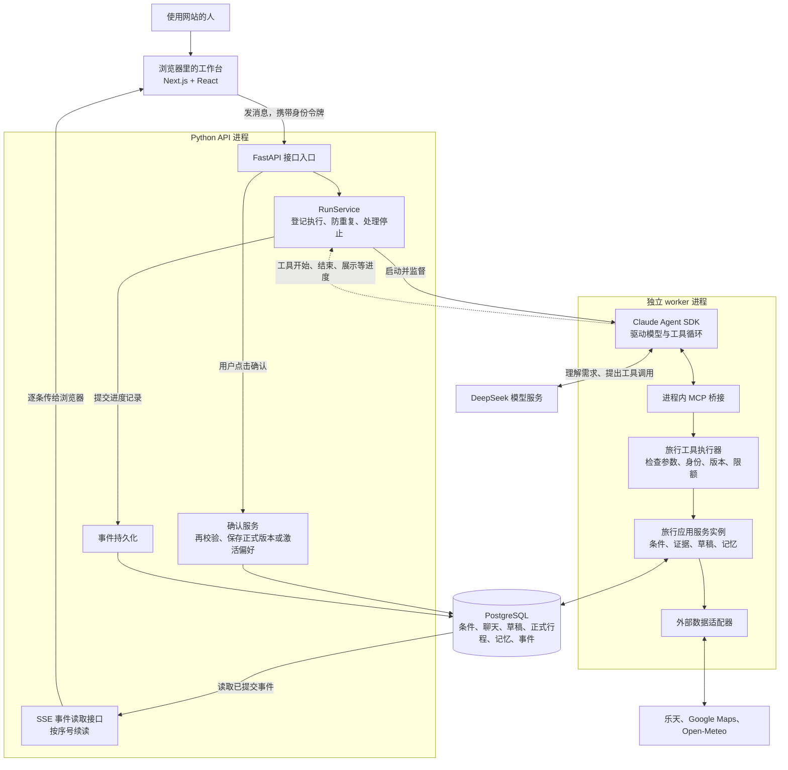

# Travel Agent 架构与名词：从一次聊天看系统

核对日期：2026-10-21。依据当前源码，不代表本次已验证线上部署或现场数据库。本文是用户问题的源码讲解，不新增业务设计；长期设计见 [design/02](../design/02-architecture.md)。

## 1. 三条链分开看



- **执行链**：发一条消息 → 登记一轮 run → SDK 调模型与工具 → 服务查数据、校验、暂存。
- **进度链**：执行中记录工具开始/结束等事件 → 先提交数据库 → SSE 把新事件传给页面。
- **确认链**：人点击确认 → FastAPI → 业务事务再校验 → 把草稿保存为正式版本，或激活偏好。模型不能代点。
- 图中多数框是代码模块，不是一框一台服务器。API 与 worker 是两个进程；进程内 MCP 和工具执行器都在 worker 一侧，业务服务代码由两侧复用，分别连接同一个 PostgreSQL。DeepSeek 和供应商是外部服务。
- 用户是人，“Next.js 工作台”是用户使用的界面。Next.js 同时提供页面路由和 `/api/*` 到 FastAPI 的代理；React 编写卡片、聊天框、按钮。

## 2. 身份、浏览器与历史

当前不是 Cookie 登录。用户点击“开始”后，后端创建演示用户并签发随机 token，浏览器把 token 和当前旅行的 session_id 放在 localStorage。API 请求通过 `Authorization: Bearer ...` 发送 token；后端对照 users 中的哈希及到期时间认出 user_id。默认有效期 30 天，可配置；不按电脑、IP 或浏览器指纹认人。

| 情况 | 当前行为 |
| --- | --- |
| 同一浏览器 profile、同一站点，关闭后再开 | 凭据仍在且未到期时，恢复同一用户并从后端读历史 |
| 同一电脑的另一个浏览器 / 另一个 profile | 默认没有原 token；重新开始通常是另一位演示用户 |
| 本地网站与线上网站 | 站点 origin 不同，localStorage 隔离，身份不会自动共用 |
| 清站点数据、隐身窗口关闭、token 到期 | 可能无法自动找回原身份；不等于数据库立即删除 |
| 同用户新建旅行 | 新 session_id，沿用同一 user_id；新旧旅行条件和临时偏好分开 |

浏览器主要存凭据、当前旅行指针；未确定是否发送成功的消息保存在当前标签页的 sessionStorage。聊天正文和业务记录主要在 PostgreSQL。当前没有完整注册账号、跨设备登录与找回身份体系，不能承诺按“同一台电脑”永久恢复。

源码：[身份存储](../../apps/web/src/lib/identity-storage.ts)、[鉴权](../../backend/services/sessions.py)、[历史恢复](../../apps/web/src/lib/use-workspace.ts)。

## 3. 不确认草稿会怎样

**已经持久化**不等于**已经正式确认**：聊天、报价证据、候选记忆、行程草稿在确认之前就会入库。

| 对象 | 是否已落库 | 是不是正式行程 |
| --- | --- | --- |
| 用户消息、助手最终回复 | 是 | 否 |
| 行程草稿 | 是，plan_drafts | 否 |
| 用户确认后的版本 | 是，plan_versions | 是 |

草稿在关闭页面或新建旅行时不会自动删除，可以从旅行历史回到旧会话查看。不过草稿当前有 **10 分钟**有效期；条件版本变化、正式版本变化也会使它无法直接确认。记录还在，不代表报价和确认资格仍有效；过期后需要重新生成/核验草稿。

新建旅行只创建新会话并切换页面状态，不删除旧旅行。“我的行程”展示正式确认的版本；未确认草稿要从旧旅行的对话/历史找。

最终回复有 32 KiB UTF-8 的存储上限并带截断标志，不能说所有原始输出都逐字、无限、永久保存。模型内部推理与全部供应商原始响应也不是公开历史。

源码：[草稿与确认](../../backend/services/plans.py)、[历史列表](../../backend/persistence/history.py)、[回复落库](../../backend/persistence/runs.py)。

## 4. RunService、任务、去重、事件、取消

- **session**：一次旅行会话，例如“京都三日游”。里面可以聊很多轮。
- **run / TaskRun**：一次消息引发的一轮 Agent 处理。例如“帮我规划”是一轮，“第二天下午换个地方”又是一轮；结构化选择提交也会触发处理。每轮可能调用很多次模型和工具。
- **RunService**：管理这一轮执行的代码模块。接收消息、分配 run_id、登记状态、启动执行、保存事件、处理停止。名称意思是“执行轮次管理服务”。
- **去重**：网络超时时浏览器用同一个 client_message_id 重发，服务端返回同一 run，不再启动一次模型。和景点只去一次无关；景点规则由行程校验处理。
- **事件**：一条进度事实，例如“运行开始”“酒店查询开始”“酒店查询结束”“卡片可展示”“本轮完成”。这里不是旅行日历里的活动。
- **取消执行**：停止本轮 Agent 继续工作，不是删除景点或取消酒店预订。已提交的业务数据保留；删除/换景点是修改行程的另一项操作。
- **已落库事件**：事件已经提交到 PostgreSQL，不需要等人确认行程。保存事件是为可靠展示、重连和排查提供依据。

源码：[RunService](../../backend/services/runs.py)、[事件及消息去重](../../backend/persistence/runs.py)。

## 5. worker、SDK、模型、工具各做什么

**worker** 是后端启动的独立工作进程，承载 SDK 执行。主 API 因而能控制它的超时、取消、子进程清理，并校验它回传的事件。它不是子 Agent，也不是另一个模型；进程隔离不是虚拟机或完整操作系统沙箱。

**Claude Agent SDK** 提供模型与工具的标准循环。项目仍要实现旅行条件、校验、事务、身份、费用和恢复边界。使用 SDK 不等于这些业务逻辑自动拥有；当前没有运行中的景点子 Agent、酒店子 Agent 架构。

**DeepSeek** 是当前线路的模型服务，读取上下文与工具说明，理解需求并提出工具调用。SDK 名称和模型供应商是两个层次；项目通过已实现的兼容接入和费用守卫连接 DeepSeek，不能推成任意模型都兼容。

**进程内 MCP 桥接**把同一份工具名称、参数 schema 和 handler 注册给 SDK。模型提出调用后，由桥接交给旅行执行器。它不要求另起公网 MCP 服务，也不是每个供应商各运行一个 MCP 服务器。

**工具执行器**检查参数结构、身份归属、条件版本、证据与限额，再调用业务服务。工具不仅有外部查询，也有 update_travel_request、propose_memory、stage_plan_change、present_travel_result 等本地功能。

**外部适配器**才处理乐天酒店、Google Maps、Open-Meteo 的 HTTP 协议与数据转换。返回哪些有用字段、压缩哪些内容是业务工具的设计；MCP 本身不会自动精简所有响应。

源码：[worker 生命周期](../../backend/providers/claude_agent/application.py)、[SDK 循环接入](../../backend/providers/claude_agent/runtime.py)、[MCP 桥接](../../backend/mcp/bridge.py)、[工具执行](../../backend/tools/travel.py)。

## 6. 本次需求与长期偏好怎样提取

聊天文字的语义判断主要由同一个主模型完成。persona 和工具 schema 告诉它哪些信息是城市、日期、人数、预算、旅行约束，哪些可以成为长期偏好。模型通过结构化工具写入，而不是把一段随意生成的摘要直接当事实。

1. 本次条件：模型调用 update_travel_request；服务端检查类型、日期、版本与允许字段。用户在表单卡上的结构化回答也能直接更新条件，不需要再调用模型提取。
2. 聊天长期候选：模型调用 propose_memory，携带 key/value/scope 和本轮用户原话 quote。服务端检查原话来源、闭合值、用户归属、已有记忆与拒绝记录，先存 proposed。
3. 表单长期候选：服务端从已经提交且仍与当前条件一致的选择卡答案直接转换；不需要另一个提取模型。
4. 规划流程中，节奏、交通、平时起床、晚上结束四项会在非冲突草稿暂存后合并成一组待确认卡。默认预选“记住”仍不代表生效，必须提交确认；可以改成“这次而已”“不要记”。
5. 确认后，记住变成 active/long_term；这次而已变成 active/trip；不要记变成 rejected。下次同用户运行读取有效记忆作为上下文与默认条件。

例如“这次早上 6 点开始玩”是本次条件，不能仅凭这句话断言用户以后都愿意早起。尚未确认的长期候选不是下次的默认偏好；本次条件可以在确认长期保存前就用于当前规划。

当前是主流程内提议，不是后台独立异步提取器；会占用参数生成、工具执行和可能的后续模型往返时间，未单独实测耗时。主流程目标长期四项受 persona 与合并卡限制，但通用 propose_memory schema 仍包含更多旧键，不能声称已在所有服务端入口硬禁止其他长期类型。

源码：[模型规则](../../backend/agent/persona.py)、[候选与确认](../../backend/services/memory.py)、[表单候选转换](../../backend/domain/memory_merge.py)、[合并展示](../../backend/services/choices.py)。

## 7. SSE 为什么看不到一个叫 SSE 的按钮

SSE（Server-Sent Events）是服务器到浏览器的持续事件传输方式。浏览器开着一次请求，后端有新记录就逐条发，不必等整个 Agent 做完。

当前已实现：`GET /runs/{run_id}/events`，浏览器经 Next.js 代理访问 `/api/runs/.../events`。后端按事件序号从 PostgreSQL 读取，5 秒空闲心跳维持连接；前端用 fetch 的 ReadableStream 解析事件，并对事件所属旅行、轮次和序号进行校验。

断线补发的例子：浏览器已收到第 12 条，网络断了；恢复后带 after=12，只读取第 13 条以后的记录。断网不会自动取消 Agent，重连不会重新查询酒店或再次付费启动同一 run。连续重连失败有上限，之后可以点“重新连接进度”。服务进程退出则另有恢复规则，不能把 SSE 重连理解成后台执行永不停止。

| 流式能力 | 当前源码状态 |
| --- | --- |
| 工具开始/结束进度 | 已实现；本次让当前步骤和最近三步直接可见，结束后可展开记录 |
| 完整酒店/草稿卡在本轮结束前显示 | 已有 presentation 事件及提前读取补卡路径；具体何时出现取决于工具完成 |
| 最终回复正文逐字输出 | 当前未完整实现；实时持久事件会移除 text，前端也主要在结束后读取 answer |
| 展示工具参数还在生成时，卡片字段逐项显示 | 当前未实现，不能把完整卡提前显示当作这个能力 |
| 模型内部思维链展示 | 不展示；进度依据实际工具事件 |

文章的 “Show the work” 与 “Stream components as they form” 是两种细度不同的建议。本次复用现有基础设施改善前者，不声称复现后者或已测得耗时下降。[原文](https://claude.com/resources/articles/the-anatomy-of-effective-commerce-agents)。

源码：[SSE 接口](../../backend/api/app.py)、[事件流](../../backend/api/events.py)、[浏览器解析](../../apps/web/src/lib/api.ts)、[重连](../../apps/web/src/lib/run-stream.ts)、[进度展示](../../apps/web/src/components/activity-drawer.tsx)。

## 8. PostgreSQL 存什么、是什么格式

它不是保存整个网页，而是关系表：一行代表一个用户、一轮执行、一条记忆或一个草稿。ID、时间、版本、状态用普通列；条件、行程项、事件等复杂对象用 JSONB。JSONB 是 PostgreSQL 可查询的结构化 JSON 类型，不是任意未经校验的大段文字；嵌套业务契约见 domain/ 与 services/views.py。

典型关系：一个 users 对应多个 sessions；一个 session 对应当前 travel_requests、多个 task_runs、草稿和计划；一个 run 对应多条 run_events；长期记忆按 user_id 复用，本次记忆还受 session_id 限制。

以下是虚构的简化字段示例（省略其他必需字段），不是用户数据库导出：

```json
{
  "travel_requests.conditions": {
    "city": "京都", "start_date": "2026-11-20", "end_date": "2026-11-22",
    "adults": 2, "rooms": 1, "currency": "JPY", "transport": "transit"
  },
  "user_memory_facts": {
    "key": "transport", "value": "transit", "scope": "long_term",
    "status": "active", "session_id": null
  },
  "run_events": {
    "sequence": 12,
    "payload": {"kind": "tool_started", "tool_name": "search_hotel_offers"}
  }
}
```

条件扩展如住宿预算、多城市段、字段来源和 conversation_state 等在 request_details 中；草稿 payload 包含 content、changes、validation、expires_at 等。UUID/日期在 JSON 中为字符串，金额使用 Decimal 的字符串表示以保留精度。运行层另有 SDK 私有会话文件、受控临时事件日志和费用守卫账本，因此“所有系统信息都在 PostgreSQL”也不准确。

下面逐表字段来自当前 SQLAlchemy 模型，便于核对格式；**未连接现场数据库**，不代表迁移已经部署到某一环境。外键和检查约束请读 [models.py](../../backend/persistence/models.py) 与迁移；迁移器另维护 alembic_version。

<!-- ORM_SCHEMA -->

### `catalog_entries`

| 字段 | PostgreSQL 类型 | 可为空 | 主键 |
| --- | --- | --- | --- |
| `id` | `VARCHAR(100)` | 否 | 是 |
| `kind` | `VARCHAR(10)` | 否 |  |
| `city` | `VARCHAR(40)` | 否 |  |
| `payload` | `JSONB` | 否 |  |

### `external_api_usage`

| 字段 | PostgreSQL 类型 | 可为空 | 主键 |
| --- | --- | --- | --- |
| `day` | `DATE` | 否 | 是 |
| `api` | `VARCHAR(20)` | 否 | 是 |
| `calls` | `INTEGER` | 否 |  |

### `google_coordinates`

| 字段 | PostgreSQL 类型 | 可为空 | 主键 |
| --- | --- | --- | --- |
| `query` | `VARCHAR(200)` | 否 | 是 |
| `place_id` | `VARCHAR(150)` | 否 |  |
| `latitude` | `DOUBLE PRECISION` | 否 |  |
| `longitude` | `DOUBLE PRECISION` | 否 |  |
| `fetched_at` | `TIMESTAMP WITH TIME ZONE` | 否 |  |

### `supplier_holds`

| 字段 | PostgreSQL 类型 | 可为空 | 主键 |
| --- | --- | --- | --- |
| `client_ref` | `UUID` | 否 | 是 |
| `id` | `UUID` | 否 |  |
| `payload` | `JSONB` | 否 |  |
| `expires_at` | `TIMESTAMP WITH TIME ZONE` | 否 |  |

### `users`

| 字段 | PostgreSQL 类型 | 可为空 | 主键 |
| --- | --- | --- | --- |
| `id` | `UUID` | 否 | 是 |
| `display_name` | `VARCHAR(60)` | 否 |  |
| `token_hash` | `VARCHAR(64)` | 否 |  |
| `token_expires_at` | `TIMESTAMP WITH TIME ZONE` | 否 |  |
| `preference_revision` | `INTEGER` | 否 |  |
| `preferences` | `JSONB` | 否 |  |
| `preference_deleted` | `BOOLEAN` | 否 |  |
| `preference_changed_at` | `TIMESTAMP WITH TIME ZONE` | 是 |  |
| `memory_forgotten_at` | `TIMESTAMP WITH TIME ZONE` | 是 |  |
| `created_at` | `TIMESTAMP WITH TIME ZONE` | 否 |  |

### `weather_forecasts`

| 字段 | PostgreSQL 类型 | 可为空 | 主键 |
| --- | --- | --- | --- |
| `city` | `VARCHAR(40)` | 否 | 是 |
| `start_date` | `DATE` | 否 | 是 |
| `end_date` | `DATE` | 否 | 是 |
| `payload` | `JSONB` | 否 |  |
| `fetched_at` | `TIMESTAMP WITH TIME ZONE` | 否 |  |

### `sessions`

| 字段 | PostgreSQL 类型 | 可为空 | 主键 |
| --- | --- | --- | --- |
| `id` | `UUID` | 否 | 是 |
| `user_id` | `UUID` | 否 |  |
| `created_at` | `TIMESTAMP WITH TIME ZONE` | 否 |  |

### `supplier_orders`

| 字段 | PostgreSQL 类型 | 可为空 | 主键 |
| --- | --- | --- | --- |
| `client_ref` | `UUID` | 否 | 是 |
| `id` | `UUID` | 否 |  |
| `payload` | `JSONB` | 否 |  |

### `user_profile_summaries`

| 字段 | PostgreSQL 类型 | 可为空 | 主键 |
| --- | --- | --- | --- |
| `user_id` | `UUID` | 否 | 是 |
| `text` | `TEXT` | 否 |  |
| `cited_fact_ids` | `JSONB` | 否 |  |
| `preference_revision` | `INTEGER` | 否 |  |
| `created_at` | `TIMESTAMP WITH TIME ZONE` | 否 |  |
| `invalidated_at` | `TIMESTAMP WITH TIME ZONE` | 是 |  |

### `business_operations`

| 字段 | PostgreSQL 类型 | 可为空 | 主键 |
| --- | --- | --- | --- |
| `session_id` | `UUID` | 否 | 是 |
| `name` | `VARCHAR(40)` | 否 | 是 |
| `key` | `VARCHAR(64)` | 否 | 是 |
| `payload` | `JSONB` | 否 |  |

### `evidence`

| 字段 | PostgreSQL 类型 | 可为空 | 主键 |
| --- | --- | --- | --- |
| `id` | `UUID` | 否 | 是 |
| `user_id` | `UUID` | 否 |  |
| `session_id` | `UUID` | 否 |  |
| `kind` | `VARCHAR(20)` | 否 |  |
| `invalidated` | `BOOLEAN` | 否 |  |
| `payload` | `JSONB` | 否 |  |
| `display_details` | `JSONB` | 是 |  |
| `hotel_metadata` | `JSONB` | 是 |  |

### `plans`

| 字段 | PostgreSQL 类型 | 可为空 | 主键 |
| --- | --- | --- | --- |
| `id` | `UUID` | 否 | 是 |
| `user_id` | `UUID` | 否 |  |
| `session_id` | `UUID` | 否 |  |
| `current_version` | `INTEGER` | 否 |  |

### `task_runs`

| 字段 | PostgreSQL 类型 | 可为空 | 主键 |
| --- | --- | --- | --- |
| `id` | `UUID` | 否 | 是 |
| `user_id` | `UUID` | 否 |  |
| `session_id` | `UUID` | 否 |  |
| `client_message_id` | `UUID` | 否 |  |
| `trace_id` | `VARCHAR(32)` | 是 |  |
| `mode` | `VARCHAR(10)` | 否 |  |
| `status` | `VARCHAR(20)` | 否 |  |
| `prompt` | `TEXT` | 否 |  |
| `user_text` | `TEXT` | 是 |  |
| `answer` | `TEXT` | 否 |  |
| `error_code` | `VARCHAR(30)` | 是 |  |
| `last_sequence` | `INTEGER` | 否 |  |
| `created_at` | `TIMESTAMP WITH TIME ZONE` | 否 |  |
| `finished_at` | `TIMESTAMP WITH TIME ZONE` | 是 |  |

### `travel_requests`

| 字段 | PostgreSQL 类型 | 可为空 | 主键 |
| --- | --- | --- | --- |
| `session_id` | `UUID` | 否 | 是 |
| `revision` | `INTEGER` | 否 |  |
| `conditions` | `JSONB` | 否 |  |
| `request_details` | `JSONB` | 是 |  |
| `source_turn_id` | `UUID` | 是 |  |

### `bookings`

| 字段 | PostgreSQL 类型 | 可为空 | 主键 |
| --- | --- | --- | --- |
| `id` | `UUID` | 否 | 是 |
| `user_id` | `UUID` | 否 |  |
| `session_id` | `UUID` | 否 |  |
| `evidence_id` | `UUID` | 否 |  |
| `payload` | `JSONB` | 否 |  |

### `choice_cards`

| 字段 | PostgreSQL 类型 | 可为空 | 主键 |
| --- | --- | --- | --- |
| `id` | `UUID` | 否 | 是 |
| `session_id` | `UUID` | 否 |  |
| `source_run_id` | `UUID` | 否 |  |
| `kind` | `VARCHAR(30)` | 否 |  |
| `expected_revision` | `INTEGER` | 否 |  |
| `content` | `JSONB` | 否 |  |
| `created_at` | `TIMESTAMP WITH TIME ZONE` | 否 |  |
| `answered_option_id` | `VARCHAR(40)` | 是 |  |
| `answered_run_id` | `UUID` | 是 |  |

### `plan_drafts`

| 字段 | PostgreSQL 类型 | 可为空 | 主键 |
| --- | --- | --- | --- |
| `id` | `UUID` | 否 | 是 |
| `plan_id` | `UUID` | 否 |  |
| `user_id` | `UUID` | 否 |  |
| `session_id` | `UUID` | 否 |  |
| `confirmed_version` | `INTEGER` | 是 |  |
| `payload` | `JSONB` | 否 |  |

### `plan_versions`

| 字段 | PostgreSQL 类型 | 可为空 | 主键 |
| --- | --- | --- | --- |
| `plan_id` | `UUID` | 否 | 是 |
| `version` | `INTEGER` | 否 | 是 |
| `payload` | `JSONB` | 否 |  |

### `run_events`

| 字段 | PostgreSQL 类型 | 可为空 | 主键 |
| --- | --- | --- | --- |
| `run_id` | `UUID` | 否 | 是 |
| `sequence` | `INTEGER` | 否 | 是 |
| `payload` | `JSONB` | 否 |  |

### `user_memory_facts`

| 字段 | PostgreSQL 类型 | 可为空 | 主键 |
| --- | --- | --- | --- |
| `id` | `UUID` | 否 | 是 |
| `user_id` | `UUID` | 否 |  |
| `key` | `VARCHAR(30)` | 否 |  |
| `value` | `JSONB` | 是 |  |
| `scope` | `VARCHAR(10)` | 否 |  |
| `session_id` | `UUID` | 是 |  |
| `status` | `VARCHAR(20)` | 否 |  |
| `source` | `VARCHAR(20)` | 否 |  |
| `source_run_id` | `UUID` | 是 |  |
| `evidence_quote` | `TEXT` | 否 |  |
| `ordinal` | `INTEGER` | 否 |  |
| `valid_from` | `TIMESTAMP WITH TIME ZONE` | 是 |  |
| `invalidated_at` | `TIMESTAMP WITH TIME ZONE` | 是 |  |
| `superseded_by` | `UUID` | 是 |  |
| `last_confirmed_at` | `TIMESTAMP WITH TIME ZONE` | 是 |  |
| `created_at` | `TIMESTAMP WITH TIME ZONE` | 否 |  |
