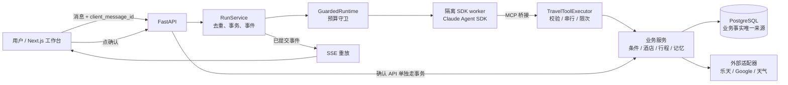

# 架构与效果复盘（2026-10-20）

给自己和面试用。回答三个问题：系统是怎么搭的、为什么这么搭、效果到底怎么样。数字只写核实过的，来源见 §8；没核实的标了 **ASSUMED**。设计细节以 [design/02](../design/02-architecture.md) 和 [ARCHITECTURE.md](../../ARCHITECTURE.md) 为准，这里只做回顾和评价。

## 1. 一句话

日本旅行 OTA 场景的对话式规划 Agent：用户在聊天窗口说需求，系统比较乐天酒店、查 Google 景点与路线和天气、生成行程草稿，用户确认后保存；用户确认过的偏好会跨会话保留。

**核心设计立场：模型只负责理解和编排，凡是涉及事实、金额、时间、归属、版本和副作用的裁决，都交给确定性代码。** 后面所有取舍都是这一条的展开。

## 2. 规模（核实过）

| 项 | 数字 | 说明 |
|---|---|---|
| 后端 Python | 23,826 行 / 148 个文件 | 含空行与注释；含 24 个迁移文件 |
| 前端 TS/TSX | 11,834 行 / 69 个文件 | Next.js 16 + React 19 |
| 测评代码 | 8,764 行 | `eval/` |
| 测试代码 | 43,513 行 | 离线收集 2,462 条；前端另有 44 个测试文件 |
| 数据库 | 20 张表、24 次迁移 | PostgreSQL |
| HTTP 接口 | 32 个 | 含 SSE 事件流 |
| 模型可用工具 | 19 个注册，线上开放 18 个 | `hold_hotel` 线上不开放 |
| 对外 MCP | 4 个只读工具 | 令牌桶限速，请求体 64KB 上限 |
| 架构决策记录 | 约 29 篇 ADR | |
| 持续集成 | 3 个 job | Python（含 Postgres）、前端、Docker 演示（含重启持久化验证） |
| 开发周期 | 2026-10-03 至 10-20，分支上 298 次提交 | 提交记录里有 AI 协作者署名，见 §7 |

线上部署在 Railway：web、api、supplier（模拟供应商）、Postgres 四个服务；2026-10-20 核对时全部在线，最近一次部署成功。

## 3. 架构

三条链：
- **主链**：消息 → RunService → 守卫 → 隔离的 SDK worker → MCP → 工具执行器 → 业务服务 → 仓储。
- **事件链**：worker 的私有进度 → 父进程验证 → 事务保存 → SSE 读取。**断线重连只读已保存的事件，绝不重新执行工具或模型。**
- **确认链**：页面点确认 → 确认 API → 业务事务。**模型没有保存行程或下单的工具**，只有一个线上不开放的 `hold_hotel`。

## 4. 关键设计取舍

| # | 问题 | 做法 | 为什么 / 代价 |
|---|---|---|---|
| 1 | Agent 还是固定流程？ | Agent 自主选工具，外面包一层很重的服务端状态机和校验（卡片、校验器、预算守卫）。固定流程只在对比实验里保留（`OrderedTools`） | 对话需求太开放，写死流程覆盖不了；但"让模型自己决定"的部分都有代码兜底。代价是模型偶发的行为偏差只能靠外壳消化 |
| 2 | 状态放哪？ | 三个状态源分开：SDK 会话（模型上下文）、应用事件（展示）、PostgreSQL（业务真相）。旅行条件每轮从数据库重读，不信聊天记录 | SDK 文件与数据库不是同一个原子事务，所以恢复时以数据库为准，不透明重放旧工具调用 |
| 3 | 价格、营业时间怎么防编造？ | 模型只传 ID，价格、名称、来源由服务端按 ID 填入；缺税费则总价为"未知"，服务端不替模型选"最低价" | 代价是展示要多走一次工具调用 |
| 4 | 行程怎么保证可用？ | **生成 → 校验 → 修复**。校验器是纯代码，35 个以上的检查码；冲突先由服务端确定性局部修复（有界：最多 12 个操作、冲突数必须严格下降、不新增景点、不放宽校验），修不掉才反馈给模型，且有轮数上限 | 防止模型在互相冲突的约束间来回改。代价：修不掉时会展示带冲突的草稿，用户无法确认保存 |
| 5 | 谁来问问题？ | 服务端发**一张合并确认卡**（起床、结束、到达、离开、同行、住宿、禁烟、床型等），城市、日期、人数、房间齐全就一定发。不靠模型自己选择怎么追问 | 见 §6 故事 A：模型曾用文字追问并声称"有卡"。代价：卡里的项目要服务端维护 |
| 6 | 酒店谁来选？ | 不自动替用户选，全部候选展示，选齐所有住宿段才规划，也可以聊天里说酒店名或贴乐天链接 | 用户明确要求；代价是多一轮交互 |
| 7 | 长期记忆 | 模型只能"提议"，必须引用本轮用户原话（至少 4 字，或整句短回复），用户在卡片上点选才生效；只有节奏、交通、起床、结束时间 4 项能长期保存，其余（住宿、禁烟、床型、同行、到达离开）只对本次行程有效。删除会清掉事实正文并切断旧会话续接 | 防止把随口一句话、第三方的偏好或工具返回的文本记成用户偏好 |
| 8 | 外部 API 失败 | 429、超时、网络、5xx 在拥有该调用的那一层**重试一次**；429 按 `Retry-After` 但最多等 3 秒；单次请求超时 8 秒；超过总期限或配额则不重试；每个外部 API 有单次运行和每日配额 | 重试只在一层做，模型不负责重试；失败时只报告真实的尝试次数，不能声称重试成功 |
| 9 | 预订安全（模拟供应商） | 下单请求带幂等键 `client_ref`（预订 ID，固定不变）；超时或响应丢失进入 `unknown`，先对账再处理，不盲目重发；模型不能下单 | 当前只对**模拟供应商**成立，线上真实酒店只提供乐天链接，不暂留、不下单 |
| 10 | 费用与限额 | 父进程持有真实密钥，CLI 子进程只拿回环令牌；每次实际 HTTP 请求先预占再结算；每次运行限制工具次数、轮数、HTTP 次数和超时 | SDK 的美元估算不能当 DeepSeek 账单 |
| 11 | 可观测 | OpenTelemetry：每次运行一个根 span，每个工具一个 span，每次模型 HTTP 请求一个 span；本地私有 JSONL 为默认，Langfuse 需显式开启；Langfuse 只收结构化字段和数值分数，不收评语和回复正文 | 完整回复文本在数据库里，评判回答要读数据库，不能读 Langfuse |
| 12 | 分层 | 11 条导入契约由 `dev check` 保护（只管直接导入）；已有违规逐条登记在分层债务清单 | 新违规会让检查变红 |

## 5. 效果

### 5.1 测评结果

方法与拼接细节见 [results-2026-10-20.md](../proposals/eval-redesign/results-2026-10-20.md)。30 道多轮题，每题 3 次，共 90 次真实运行（DeepSeek、乐天、Google、Open-Meteo），成功由代码查数据库终态和工具轨迹判定：

| 指标 | 结果 |
|---|---|
| 任务成功率 | **87 / 90（96.7%）**，95% 区间 90.7%–98.9% |
| 稳定通过率（同题 3 次全过） | **28 / 30（93.3%）**，95% 区间 78.7%–98.2% |
| 需求澄清 / 工具故障 / 长期记忆 / 越界 / 对抗 | 15/15、15/15、18/18、9/9、6/6 |
| 主流程 / 中途变更 | 11/12、13/15 |

最终数字是**首轮全量发现测评自身问题、修复后对部分题目重跑、再按更严判定拼接**的结果。首轮原始成绩是 84.4% / 80%，两个数字都要带上。

### 5.2 响应时间与成本（90 次最终运行）

| 项 | 数值 |
|---|---|
| 单个对话轮耗时 | 中位 8.0 秒，p95 32.9 秒，最长 55.8 秒 |
| 首个可用回复 | 中位 5.2 秒，p95 20.8 秒 |
| 一次完整运行（多轮） | 中位 20.8 秒；完整规划类题中位 81.5 秒、最长 92.8 秒 |
| 单次运行成本 | 中位 0.145 元，p95 0.96 元；90 次合计 23.23 元（DeepSeek flash） |

完整规划的整次运行包含选酒店在内的多轮交互，不等于用户单次等待时间。耗时只记录、不计入成功判定（负责人决定）。

### 5.3 做得好的

- **记忆链路**：提取 → 落库 → 跨会话注入 prompt → 行为生效，四层分别核对，18/18。其中第三层读的是真实发给模型的 system prompt，不是服务层快照。
- **故障恢复**：9 种故障注入，15/15。可恢复的静默重试；不可恢复的（无房、预算内无房）如实说明，没有编造。
- **诚实**：代码对账的 7 类声明（已出卡、自动重试次数、报价过期、在预算内、已选酒店、已记住、已订好），最终 90 次里**没有一次**与实际状态不符，另有 1 次无法判定。注意：这里**没有**对"编造价格"的专门检测，价格是否准确靠"模型只传 ID、价格由服务端填入"的设计保证，没有单独测量。规划不完整、被服务端去掉景点时，回复里会如实说明。
- **边界**：订机票、海外目的地、要求绕过确认、伪造系统指令，全部明确拒绝且不产生订单或保存。

### 5.4 做得不好的

| 问题 | 证据 | 判断 |
|---|---|---|
| 局部修改已有草稿 | "只替换第二天下午"只有 1/3 做到。一次是 3 次暂存全部报错，一次是整份重排 | 真实的能力短板。其中一次报错里模型说"系统要求先有正式行程版本才能局部修改"，可能是**产品流程（先草稿后确认）与补丁语义不一致**，**ASSUMED**，待核实 |
| 规划完整度不稳 | 单城市全流程 2/3，有一次两晚的行程只留下 2 个景点 | 服务端校验会去掉无法核实地点证据的景点，模型没有补足 |
| 行程里"未知"项多 | 路线耗时、营业时间、其他费用大量未知 | 一部分是测评自设配额耗尽造成的；真正的数据覆盖缺口（营业时间）需要单独测量，**不能直接归因于"没接数据源"**，路线接口其实已接入 |
| 评委（judge）的体验分 | 没有经过人工校准 | 不能当成绩引用 |

## 6. 过程中的问题与教训

**A. 模型用文字追问，还声称"有卡片"。** 合并确认卡某次没有出现，模型用文字问了儿童年龄并说"请在卡片里确认"。教训：流程控制不能依赖模型的自觉。改为服务端按条件发卡，并让 `update_conversation_state` 返回卡片状态（已发、待提交、没有），模型据此说话。[复盘 §4](../plans/2026-10-19-review.md)

**B. 测评的第一次全量，大部分失败是测评自己的问题。** 首轮 76/90。逐条读对话后发现：脚本没回答 agent 合理的追问（房间数、有无儿童），导致对话停在第一轮；运行器在卡片提交时会拒绝整张表。修的都是测量工具，agent 没有改动。教训：**先读对话再下结论**，分数下降不等于 agent 变差，分数上升也不等于 agent 变强。

**C. 判定过松，把残缺的规划算成成功。** 两晚的"完整行程"只保存了一个景点，也被判成功，因为硬检查只看"计划已保存"。补上了"草稿无冲突"和"每个完整游玩日至少 2 个景点"。同时发现"只替换一处"的硬检查被降级后，这道题已经不可能因它真正要测的能力而失败，也一并恢复。教训：每道题都要问一句——**如果 agent 什么都没做对，这道题会失败吗？**

**D. 一个测试意外发起了真实调用。** 把 `--max-cny` 改成可选后，一个只想验证参数报错的测试真的跑了起来，花了约 0.34 元。教训：靠"某个参数缺失会报错"来保证测试不联网，是脆弱的前提。现在在 pytest 环境下一律拒绝 `--live`。

**E. 测评自设的配额掩盖了真实表现。** 90 次共用一个临时库，Google 每日上限在后半段被耗尽，对话里出现"额度已用完"，一部分"未知"项由此而来。教训：测评要把自己的保护阈值和被测系统的行为分开。

**F. 工具名幻觉与守卫。** DeepSeek 偶发编造不存在的工具名（如 `search_places_dummy`），守卫按设计停止本轮，用户要再发一句才能继续。**有意不改**：放宽它等于动一条安全边界。

**G. 统一规划按钮偶发被禁用，根因没找到。** 第三次尝试后恢复正常，子代理用真实数据也无法复现。已加"被阻止时显示准确原因"的提示，按要求不再继续修。教训：能复现才算修好；没有复现的"恢复正常"只是观察，不是结论。

## 7. 诚实边界

- 这是**单人项目**，场景是日本国内、2026 年 12 月的行程，用户是按脚本行动的模拟用户。
- 测评集是按系统设计编写的，**没有留出集**，不能和其他 Agent 横向比较。
- 只验证了 DeepSeek 线路；Claude 原生线路没有真实验证，相关的 8 个测试在这台机器上失败（推测与固定 CLI 版本有关，**ASSUMED**）。
- 线上酒店只提供乐天链接，**预订部分只针对模拟供应商**。
- 开发过程大量使用 AI 协作：分支提交里有 Claude（Sonnet 5.5 约 76 次、Opus 5.5 约 7 次）、Codex（约 34 次）、Cursor（约 12 次）的联合署名。架构取舍、测评设计、问题定位与验收由我负责，面试时如实说明。
- 数据保留与删除、live 额度保护、草稿证据 30 分钟有效期，均按负责人决定暂缓。

## 8. 数字出处

| 数字 | 来源 |
|---|---|
| 行数、文件数、表数、迁移数、路由数、工具数、测试数、提交数 | 核实任务的统计（`wc -l`、`pytest --collect-only`、AST 扫描），2026-10-20 |
| 测评结果 | [results-2026-10-20.md](../proposals/eval-redesign/results-2026-10-20.md)，运行目录 `.cache/eval-v3/`（私有，未入库） |
| 耗时与成本 | 对拼接后的 90 次运行的 `trials.jsonl` 计算 |
| 重试策略、档位、校验码、预订状态机、记忆规则 | 代码 `backend/adapters/external_api.py`、`backend/profile.py`、`backend/domain/validator.py`、`booking.py`、`memory.py`，核实任务逐条引用行号 |
| 部署状态 | Railway 状态查询，2026-10-20 |

## 9. 下一步（按价值）

1. 查清局部修改失败的原因，修好后用同一道题回归（先看是否是"草稿不能打补丁"的流程问题）。
2. 找两位真人按评分表复核 20 次运行，校准 judge，把体验分纳入成绩。
3. 留一批全新的题，在系统固定之后第一次跑，作为留出集。
4. 单独测量营业时间和路线的覆盖缺口，区分"数据没覆盖"和"配额耗尽"。
5. 补齐没验证的路径：全新账号、"同行儿童"分组、点"否"后填城市、一家酒店都搜不到。
6. 整理 PR #9 并合并 main（标题和说明都是旧的）。
